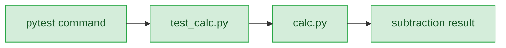
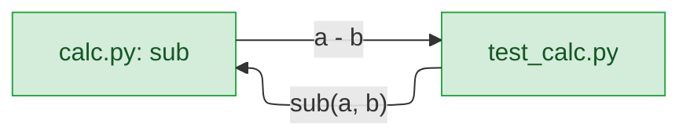
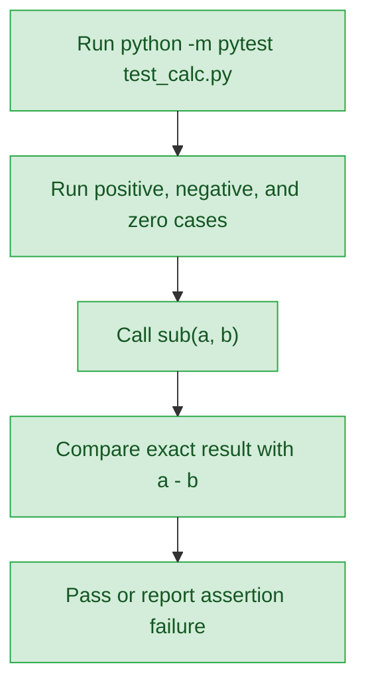
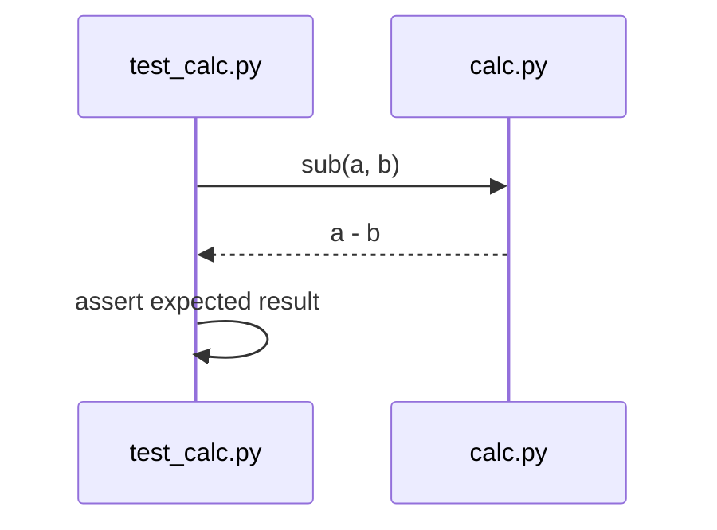
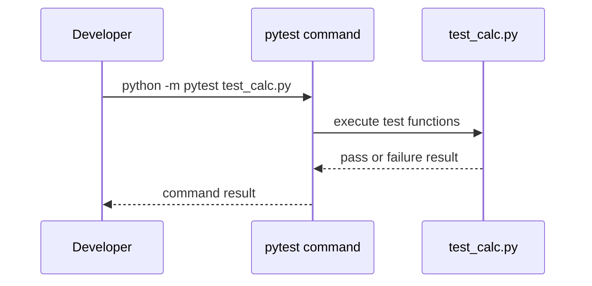

# add-sub — detail design

## Reference

Stance doc: 2026-09-19-add-sub-stance.md
Decisions doc: 2026-09-19-add-sub-decisions.md
Status: approved 2026-09-19

### Traceability

| From the high-level design | Satisfied by | Status |
|---|---|---|
| UC1 | `calc.py` exposes `sub(a, b)`; `test_calc.py` checks positive, negative, and zero operand cases. | covered |
| UC2 | `python -m pytest test_calc.py` is the verification command. | covered |

## Requirement

Add the requested root-level subtraction helper and focused tests. It succeeds when `sub(a, b)` evaluates `a - b`, the three requested operand categories are covered, and `python -m pytest test_calc.py` passes. `.claude/track/add-sub/discover.md:7-10`

## Glossary

| Term | Definition | Where it lives |
|---|---|---|
| `calc.py` | Standalone module containing the requested subtraction helper. | new — `calc.py` |
| `sub` | Function that returns the expression `a - b`. | new — `calc.py` |
| `test_calc.py` | Focused test module for the subtraction helper. | new — `test_calc.py` |

## Budgets

| What | Number | Where it comes from |
|---|---|---|
| Required operand categories | 3 | Positive, negative, and zero are required by `.claude/track/add-sub/discover.md:9`. |

## Design decisions

- Add only the two root-level files named in the approved stance; application integration and package structure conflict with its invariants. `2026-09-19-add-sub-stance.md:18-19`
- Implement `sub` as the direct expression `a - b`; no validation or exception translation is added because it is out of scope. `2026-09-19-add-sub-stance.md:19,44`
- Use three direct `test_` functions with exact assertions and the selected literal pairs. This follows the verified repository test pattern at `python/pip/tests/test_report.py:9-22` and the Tier 3 decisions in `2026-09-19-add-sub-decisions.md:37-38`.

## Diagrams

### Architecture

The new path has one boundary: the test module imports the new standalone module.

### Component

The only new contract is the `sub(a, b)` call and its subtraction result.

### Flow

The assertion is the verification boundary: each required operand category reaches the same helper.

### Sequence — UC1

The test owns the expected values; `calc.py` only returns the requested expression result.

### Sequence — UC2

The command runs only the new focused test file, matching the requested validation scope.

## Implementation spec

### `calc.py`

- **Responsibility:** Return the requested subtraction result.
- **Interface:** `def sub(a, b):`
- **Data:** Inputs are `a` and `b`; output is their expression result, `a - b`. No input type contract is added.
- **Errors:** No validation or exception translation is added; unsupported inputs are outside the requested behaviour.
- **Concurrency:** No shared state, ordering requirement, or retry behaviour.
- **Observability:** No logs, metrics, or runtime events are added.
- **Where it lives:** New repository-root file `calc.py`.
- **What it reuses:** Nothing; this is a new standalone helper.

### `test_calc.py`

- **Responsibility:** Prove the subtraction result for the three requested operand categories.
- **Interface:** `def test_sub_with_positive_operands():`, `def test_sub_with_negative_operands():`, and `def test_sub_with_zero_operand():`.
- **Data:** The tests call `sub(5, 2)` expecting `3`, `sub(-5, -2)` expecting `-3`, and `sub(0, 2)` expecting `-2`.
- **Errors:** An incorrect result produces a failed assertion; no test-specific recovery is added.
- **Concurrency:** The tests share no mutable state and require no ordering.
- **Observability:** Verification uses the requested pytest command; no application instrumentation is added.
- **Where it lives:** New repository-root file `test_calc.py`.
- **What it reuses:** The direct-call and exact-assert pattern at `python/pip/tests/test_report.py:9-22`.

## Naming

| Name | What it is | Chosen by |
|---|---|---|
| `calc.py` | Root-level helper module. | the user requirement, `.claude/track/add-sub/discover.md:7` |
| `sub` | Subtraction helper function. | the user requirement, `.claude/track/add-sub/discover.md:7` |
| `test_calc.py` | Root-level focused test module. | the user requirement, `.claude/track/add-sub/discover.md:8` |
| `test_sub_with_positive_operands` | Positive-operand test function. | follows the `test_` function convention at `python/pip/tests/test_report.py:9-20` |
| `test_sub_with_negative_operands` | Negative-operand test function. | follows the `test_` function convention at `python/pip/tests/test_report.py:9-20` |
| `test_sub_with_zero_operand` | Zero-operand test function. | follows the `test_` function convention at `python/pip/tests/test_report.py:9-20` |

## Change points

| Path | Change | Exists today |
|---|---|---|
| `calc.py` | Add `sub(a, b)` returning `a - b`. | no |
| `test_calc.py` | Add three direct tests for positive, negative, and zero operands. | no |

## Failure modes

| Situation | What happens | What the caller sees |
|---|---|---|
| `sub` returns a value other than the expected difference. | The exact assertion is not green. | Verification is not green. |
| An input is outside the expression's supported operands. | No new validation policy handles it. | Behaviour is outside the requested contract. |
| The local environment cannot run the requested pytest command. | Verification cannot complete. | The command is not green; availability is verified during build/verify. `.claude/track/add-sub/discover.md:18` |

## Rollout

- **Ship in pieces:** No. The smallest useful release contains both the helper and its tests.
- **Existing data:** None; this change adds no data store, migration, or backfill.
- **In-flight callers:** No existing caller contract is a change point; a caller can adopt `sub` only after this addition.
- **Rollback:** Revert the change; no data or configuration is written.

## Verification

| Criterion | Level | What it needs | Green before |
|---|---|---|---|
| UC1 | unit | The three literal operand pairs and exact expected results in `test_calc.py`. | All three tests pass. |
| UC2 | unit | `python -m pytest test_calc.py` in the repository root. | The command exits successfully. |

## Work breakdown

| Unit | Depends on | Can run alongside | Done when |
|---|---|---|---|
| 1 — focused tests | nothing | Yes — unit 2; the fixed `sub(a, b)` interface is already specified. | `test_calc.py` contains the three specified direct assertions. |
| 2 — subtraction helper | nothing | Yes — unit 1; run the verification command after both units finish. | `calc.py` defines `sub(a, b)` and `python -m pytest test_calc.py` is green. |

### Upstream blockers

| What | Owned by | Needed before |
|---|---|---|
| Local availability of the requested pytest command | Local execution environment | Verification of unit 2; this remains an assumption recorded at `.claude/track/add-sub/discover.md:18`. |
