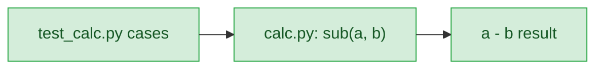

# add-sub — stance

## Status

approved 2026-09-19

## Optimises for

Provide the requested subtraction helper as a directly importable repository-root module, with a focused test file that can be run by the requested command. The requested behaviour is observable when `sub(a, b)` returns `a - b` and the positive, negative, and zero cases pass. [`.claude/track/add-sub/discover.md:7`](../../.claude/track/add-sub/discover.md#L7) [`.claude/track/add-sub/discover.md:9`](../../.claude/track/add-sub/discover.md#L9)

## Sacrifices

- Integration with either existing Python example project is not provided; the requested files instead live at repository root. [`.claude/track/add-sub/discover.md:7`](../../.claude/track/add-sub/discover.md#L7) [`.claude/track/add-sub/discover.md:8`](../../.claude/track/add-sub/discover.md#L8)
- No calculator package, additional arithmetic operations, input-validation policy, or public API beyond `sub(a, b)` is introduced. [`.claude/track/add-sub/discover.md:7`](../../.claude/track/add-sub/discover.md#L7)

## Invariants

**This system's:**

- `calc.py` and `test_calc.py` remain repository-root files, and `test_calc.py` verifies `sub(a, b)` for positive, negative, and zero operands. [`.claude/track/add-sub/discover.md:7`](../../.claude/track/add-sub/discover.md#L7) [`.claude/track/add-sub/discover.md:9`](../../.claude/track/add-sub/discover.md#L9)
- The helper's result is exactly the Python expression `a - b`. [`.claude/track/add-sub/discover.md:7`](../../.claude/track/add-sub/discover.md#L7)

**Cross-project:**

- The build must preserve the requested validation command: `python -m pytest test_calc.py`. [`.claude/track/add-sub/discover.md:10`](../../.claude/track/add-sub/discover.md#L10)

## Rejected stances

- Put the helper into `python/uv`: this conflicts with the confirmed repository-root module and test-file requirement. [`.claude/track/add-sub/discover.md:7`](../../.claude/track/add-sub/discover.md#L7) [`.claude/track/add-sub/discover.md:8`](../../.claude/track/add-sub/discover.md#L8)
- Create a reusable calculator package: this adds package structure and behaviours not required to deliver the single helper and its focused tests. [`.claude/track/add-sub/discover.md:7`](../../.claude/track/add-sub/discover.md#L7)

## Use cases / Issues

- UC1 — A developer imports `sub` from root-level `calc.py` and receives the difference of two operands; positive, negative, and zero operands demonstrate the result. [`.claude/track/add-sub/discover.md:7`](../../.claude/track/add-sub/discover.md#L7) [`.claude/track/add-sub/discover.md:9`](../../.claude/track/add-sub/discover.md#L9)
- UC2 — A developer runs `python -m pytest test_calc.py` and receives the test result for the requested helper. [`.claude/track/add-sub/discover.md:10`](../../.claude/track/add-sub/discover.md#L10)

## Overview

The green path is newly added: tests invoke the helper and compare its subtraction result.

## Out of scope

- Extending the helper into an existing application or a reusable package.
- Arithmetic operations other than subtraction, type-validation rules, and tests beyond the requested positive, negative, and zero operand coverage. [`.claude/track/add-sub/discover.md:9`](../../.claude/track/add-sub/discover.md#L9)
